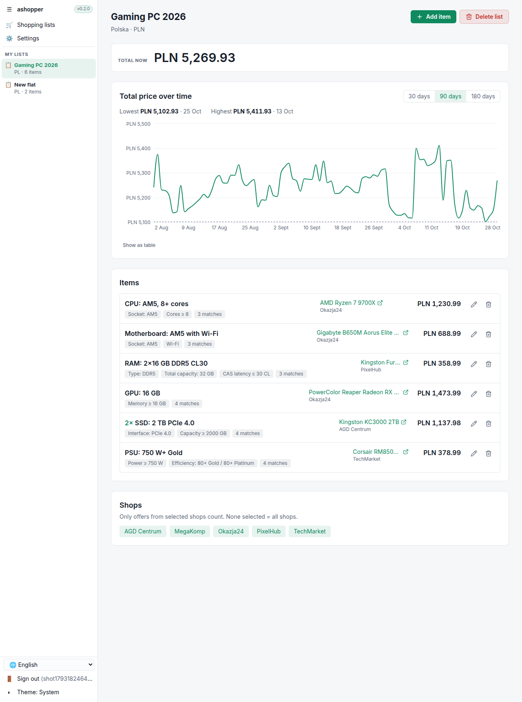
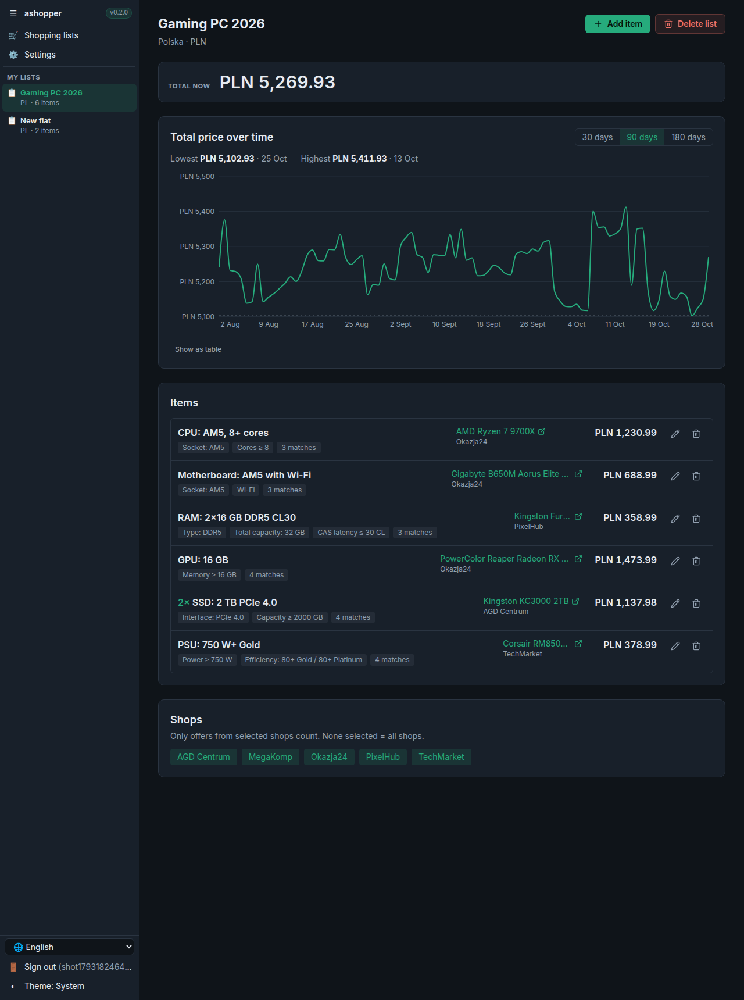

# ashopper

Track what a **set of loosely specified things** costs over time, so you know when it's a good moment to buy.

You don't track a product. You track a requirement, like "any 2×16 GB DDR5 kit with CL ≤ 30" or "any AM5 motherboard with Wi-Fi". ashopper finds every product that matches, takes the cheapest in-stock offer each day, and charts the total for the whole list. It works for a PC build, or for furnishing a flat ("any No Frost fridge ≥ 300 l").

- Limit a list to the shops you care about, and add your personal discount per shop.
- Poland first. Markets are data, so Ukraine or any other country means adding a row plus a price source.

| Light | Dark |
|---|---|
|  |  |

More screens are in [docs/screenshots](docs/screenshots): the lists overview, the item editor and the phone layout. The UI follows the same design language as the sibling apps (abook, nopds…); see [docs/research/sibling-ui-design.md](docs/research/sibling-ui-design.md).

## Stack

| Part | Tech |
|---|---|
| API | .NET 10 minimal APIs, EF Core 10, ASP.NET Core Identity, JWT access tokens and rotating refresh tokens |
| Collector | .NET console app, run on a schedule; pluggable `IPriceSource` per market |
| UI | React 19 + TypeScript + Vite, Tailwind v4, TanStack Query, React Router, Recharts, i18next (en/pl/uk), lucide icons, typed client generated from OpenAPI |
| Data | SQL Server locally, Azure SQL Database (free offer) in the cloud |
| Hosting | Azure Container Apps (UI nginx app, internal API app, collector and migrate jobs), images on GHCR, Bicep |

See [docs/architecture.md](docs/architecture.md) for the design and how it scales.

## Run locally

Prerequisites: .NET 10 SDK, Node 22, Docker.

**Option A: everything in containers.** Open http://localhost:8080 afterwards.

```bash
docker compose --profile app up -d --build                    # sqlserver, migrate, api, ui (+ collector runs once)
docker compose --profile app run --rm collector collect       # collect again later
```

**Option B: database in Docker, code from your IDE.** Best for development.

```bash
docker compose up -d sqlserver
dotnet run --project backend/src/Ashopper.Collector -- migrate
dotnet run --project backend/src/Ashopper.Collector -- collect --backfill-days 180   # fake source: 180 days of history
dotnet run --project backend/src/Ashopper.Api                                         # http://localhost:5080
cd frontend && npm install && npm run dev                                             # http://localhost:5173
```

Register any email and password. Emails (confirmation, password reset) are written to the API log in dev.

## Tests

```bash
dotnet test backend/Ashopper.slnx      # unit tests + integration tests (needs Docker: SQL Server via Testcontainers)
cd frontend && npm test                # vitest
```

## Working on the API contract

The API writes `backend/src/Ashopper.Api/openapi/ashopper.json` on every build. The UI's types are generated from it:

```bash
dotnet build backend/src/Ashopper.Api
cd frontend && npm run gen:api         # → src/api/schema.d.ts
```

CI fails if either generated file is out of date.

## Database migrations

```bash
dotnet ef migrations add <Name> -p backend/src/Ashopper.Infrastructure -s backend/src/Ashopper.Api -o Persistence/Migrations
```

Migrations are applied by `Ashopper.Collector migrate`: on Azure as a one-off job per deploy, locally by the `migrate` compose service. In Development the API also migrates on startup.

## Deploy to Azure (free tier)

The free offers used:
- **Container Apps:** a free monthly grant (180k vCPU-seconds, 2M requests), and every app scales to zero.
- **Azure SQL Database:** a free offer (100k vCore-seconds and 32 GB per month, auto-pauses, `AutoPause` when exhausted, so it never bills).
- **Log Analytics:** capped at about 5 GB per month.

### 1. Azure side, one time

```bash
az group create -n ashopper -l westeurope
# OIDC identity for GitHub Actions: no stored Azure credentials
az ad app create --display-name ashopper-gh        # note appId
az ad sp create --id <appId>
az role assignment create --assignee <appId> --role Contributor --scope /subscriptions/<sub>/resourceGroups/ashopper
az ad app federated-credential create --id <appId> --parameters '{"name":"gh-main","issuer":"https://token.actions.githubusercontent.com","subject":"repo:<owner>/ashopper:environment:production","audiences":["api://AzureADTokenExchange"]}'
```

### 2. GitHub side, environment `production`

- **Variables:**
  - `AZURE_CLIENT_ID`, `AZURE_TENANT_ID`, `AZURE_SUBSCRIPTION_ID`, `AZURE_RESOURCE_GROUP`
  - optional: `APP_PREFIX` (default `ashopper`)
  - `GHCR_USERNAME`, only if the packages stay private
- **Secrets:**
  - `SQL_ADMIN_PASSWORD`
  - `JWT_SIGNING_KEY`: generate with `openssl rand -base64 48`
  - `GHCR_TOKEN`: a PAT with `read:packages`, only if the packages are private. Alternatively, make the three packages public.

### 3. First rollout

1. Push to `main`. **Deploy API + collector** and **Deploy UI** build and push the images. Their Azure steps fail the first time because the infrastructure doesn't exist yet.
2. Run **Deploy infrastructure**. It prints `uiUrl`.
3. Re-run **Deploy API + collector**. This runs the migrate job, then rolls out the API.

After that, every push to `main` deploys only the side that changed: `backend/**` or `frontend/**`.

## Price sources

Only the **fake** source is implemented. It is deterministic, generates realistic waves and sales weeks, and covers PL and UA. Real ones need API access:

- **Ceneo (PL):** Partner Program API, only for members of the Ceneo affiliate program. Apply first.
- **Allegro (PL):** `GET /offers/listing` requires a verified application.
- **Hotline.ua / ek.ua (UA):** no public API. It's either a partnership or scraping, so check their terms.

How to add one: [docs/architecture.md#adding-a-price-source](docs/architecture.md#adding-a-price-source).
